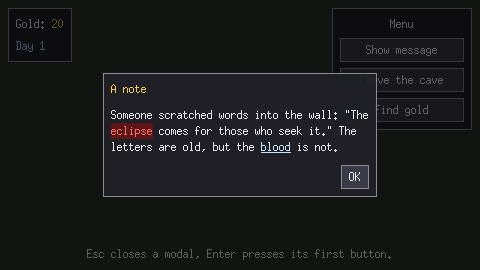
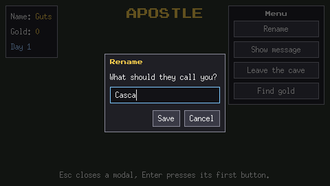

# apostle-ui

A small UI package for [Ebitengine](https://ebitengine.org/) games, made for
[Apostle](https://github.com/DWethmar/apostle). It has:

- **Panels** with text and buttons, placed on the screen (HUDs, menus).
- **Rich text**: color or highlight single words, and make them clickable.
- **Modals**: dialogs in the middle of the screen that take all input until
  they close.
- **Text fields** that work with the platform's input method, so Japanese or
  Chinese input and on-screen keyboards work too.



```sh
go get github.com/dwethmar/apostle-ui
go run ./examples/demo   # try it
```

## Usage

Build elements once. Keep a pointer to anything you want to change later.

```go
import ui "github.com/dwethmar/apostle-ui"

u := ui.New()

// A HUD panel in the top-left corner, 8px from the edges.
gold := ui.NewText("Gold: 0")
u.Place(ui.NewPanel(gold), ui.TopLeft, 8, 8)

// A message with an OK button.
u.Alert("Welcome", "You wake up in a dark cave.")

// A question.
u.Open(ui.NewModal("Leave the cave?", ui.NewText("It is dark outside.")).
	AddButton("Leave", leave). // runs leave, then closes
	AddButton("Stay", nil))    // just closes
```

Rich text is a `Text` made of spans. Each span can have its own color, a
highlight behind it, and a click handler:

```go
u.Open(ui.NewModal("A note", ui.NewRichText(
	ui.NewSpan("The "),
	ui.NewSpan("eclipse").Color(red).Highlight(darkRed),
	ui.NewSpan(" is coming. Look at the "),
	ui.NewSpan("blood").OnClick(func() { u.Alert("Blood", "Still wet.") }),
	ui.NewSpan("."),
)).AddButton("OK", nil))
```

A clickable span without its own color uses the theme's `Link` color and is
underlined while the pointer is over it. Keep a pointer to a span to change
just that part, e.g. `amount.SetText("20")`.

A text field in a modal, focused so the player can type straight away:

```go
name := ui.NewTextField("Your name").MaxLength(16)
u.Open(ui.NewModal("Rename", name).
	AddButton("Save", func() { player.Name = name.Text() }).
	AddButton("Cancel", nil))
u.Focus(name)
```



Hook it into your game:

```go
func (g *Game) Update() error {
	used := g.ui.Update()
	ebiten.SetCursorShape(g.ui.CursorShape())
	if used || g.ui.Focused() != nil {
		return nil // the UI used this frame's input, or the player is typing
	}
	g.gold.SetText(fmt.Sprintf("Gold: %d", g.coins))
	// ... the rest of the game
}

func (g *Game) Draw(screen *ebiten.Image) {
	// ... draw the world
	g.ui.Draw(screen) // last, so the UI is on top
}

func (g *Game) Layout(int, int) (int, int) {
	g.ui.SetScreenSize(screenW, screenH)
	return screenW, screenH
}
```

`Update` returns true while a modal is open, when a click landed on a panel, or
when a key went to a text field, so the game knows to ignore it. While
`Focused()` is not nil the player is typing, so leave the keyboard alone.
`CursorShape` gives the right mouse cursor: a text cursor over fields, a hand
over buttons and clickable spans.

If your game sends pointer events to the UI itself with `HandleInput`, call
`UpdateKeys` once per frame as well, for typing and the Escape and Enter keys.

## Elements

| Element | Made with | Notes |
|---|---|---|
| Text | `NewText(s)` | Wraps to the width it is given. `SetText`, `Color`, `Font`, `Align`. |
| Rich text | `NewRichText(spans...)` | A `Text` made of spans. `SetSpans`, `Add`. |
| Span | `NewSpan(s)` | Part of a rich text. `SetText`, `Color`, `Font`, `Highlight`, `OnClick`. |
| Button | `NewButton(label, fn)` | Fires on press + release over it. `SetLabel`, `SetDisabled`, `SetSelected` (e.g. the active tool). |
| Panel | `NewPanel(children...)` | Background and border; children top to bottom. `Width`, `Padding`, `Gap`, `Align`. |
| Column / Row | `Column(...)`, `Row(...)` | Layout without a box. `Gap`, `Width`, `Align`, `Justify`. |
| Modal | `NewModal(title, children...)` | Open with `u.Open`. `AddButton`, `OnClose`, `Dismissible`, `Width`, `Close`. |
| Text field | `NewTextField(placeholder)` | One line of typing. `SetText`, `Text`, `MaxLength`, `Width`, `OnChange`, `OnSubmit`. Focus with a click or `u.Focus`. |

Every element has `SetVisible`, `Visible` and `Bounds`. Hidden elements take no
space.

Anchors for `Place`: `TopLeft`, `Top`, `TopRight`, `Left`, `Middle`, `Right`,
`BottomLeft`, `Bottom`, `BottomRight`. To pin something to a point instead, such
as a popup next to a character, call `PlaceAt(e, x, y)` every frame; it is
kept on screen.

Keys:

- **Escape** unfocuses a text field and closes the top modal.
- **Enter** runs a focused field's `OnSubmit`; without one, it presses the top
  modal's first button.
- **Backspace**, **Delete**, **Left**, **Right**, **Home** and **End** edit a
  focused field, repeating while held.

## Styling

Everything uses `u.Theme`: font, padding, gap, the widest a modal may grow, and
all colors. The default font is a 12px bitmap font. To use your own:

```go
u.Theme.Face = myFace       // any text/v2 Face
u.Theme.TitleFace = bigFace // modal titles (nil means Face)
u.Theme.Title = color.RGBA{0xff, 0x80, 0x80, 0xff}
```

Fonts can also be set per text, or per span for a single word:

```go
ui.NewText("APOSTLE").Font(bigFace)

ui.NewRichText(
	ui.NewSpan("The "),
	ui.NewSpan("ECLIPSE").Font(pixelFace),
	ui.NewSpan(" is coming."),
)
```

A span's font wins over its text's font, which wins over the theme. Spans of
different sizes on one line share a baseline, and the line is as tall as its
tallest font. Buttons use the theme's `Face`.

## Wrapping

Ebitengine's `text/v2` does not wrap text; it only breaks lines at `\n`. This
package wraps itself, greedily at spaces, measuring with `text.Advance`. That is
right for languages that put spaces between words. Languages that don't
(Chinese, Japanese, Thai) would need Unicode line breaking, which
`github.com/go-text/typesetting/segmenter` provides and could be swapped in.

## Testing

`HandleInput(ui.Input{...})` is `Update` with input you supply, so clicks and
key presses can be tested without a window — see [ui_test.go](ui_test.go).
